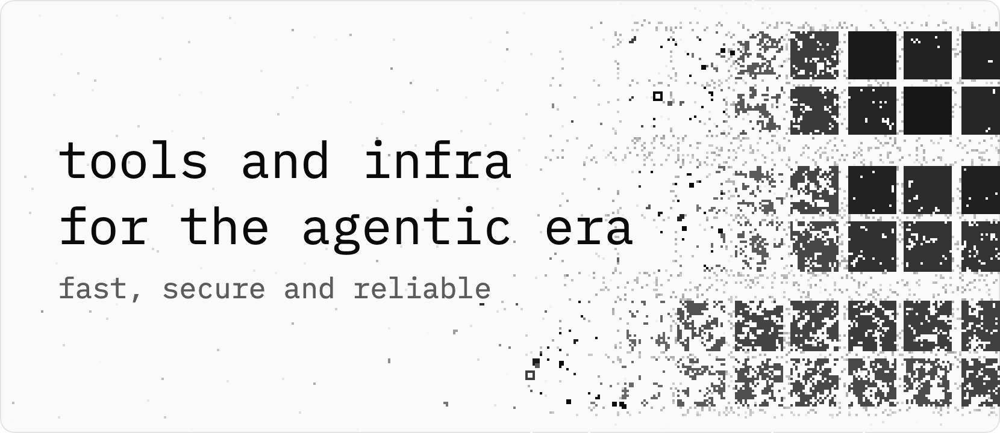

<p>
<picture>
  <source media="(prefers-color-scheme: dark)" srcset="hero-dark.png">
  <source media="(prefers-color-scheme: light)" srcset="hero.png">
  
</picture>
</p>

Open-source tools and infrastructure for agents, developers and security teams, all in Rust.

Agents now write code, run commands and hold credentials on real machines, but most of the tools around them were built for one person at a keyboard. Whiteheap builds tools for that shift.

We want absolute excellence in software. Each tool leaves your work alone whenever it cannot tell what is safe to touch, and says what it did in a few words. It uses as little CPU and memory as it can, and we measure both on each code change before it ships. Each command-line tool is one Rust binary, and each app is Rust around the system web view. All keep their dependencies as few as we can manage, and every release carries SHA-256 checksums and a build-provenance attestation.

## Tools

### [residue-cli](https://github.com/whiteheap/residue-cli)

<p>
<picture>
  <source media="(prefers-color-scheme: dark)" srcset="https://raw.githubusercontent.com/whiteheap/residue-cli/main/docs/assets/hero-dark.png">
  <source media="(prefers-color-scheme: light)" srcset="https://raw.githubusercontent.com/whiteheap/residue-cli/main/docs/assets/hero.png">
  
</picture>
</p>

**residue removes a worktree only when nothing in it would be lost, whichever coding agent left it.**

It runs on macOS, Linux and FreeBSD. The install script installs residue and, on macOS and Linux, turns on automatic cleanup:

```sh
curl -fsSL https://residue.whiteheap.com/install.sh | sh
```

Homebrew alone installs residue without automatic cleanup: `brew install whiteheap/tap/residue`.

Website: [residue.whiteheap.com](https://residue.whiteheap.com) · Source: [github.com/whiteheap/residue-cli](https://github.com/whiteheap/residue-cli)

### [residue-ui](https://github.com/whiteheap/residue-ui)

**The Mac app for residue: see which worktrees can go and why, move them to the trash, restore them, and see what residue has freed.**

It runs on macOS 13 or later, on Apple silicon and Intel, with residue inside. Download [residue-macos.dmg](https://residue.whiteheap.com/download/macos), open it, and drag residue to Applications. It is not notarized yet, so the first launch needs Open Anyway in System Settings, Privacy & Security.

Shown with example repositories and a made-up history of removals:

<p>

</p>

<p>

</p>

Source: [github.com/whiteheap/residue-ui](https://github.com/whiteheap/residue-ui)

## The name

Whiteheap joins white hat and heap. A white hat is a hacker who finds weaknesses so they can be fixed, and works in the open. The heap is the memory a program asks for while it runs.
